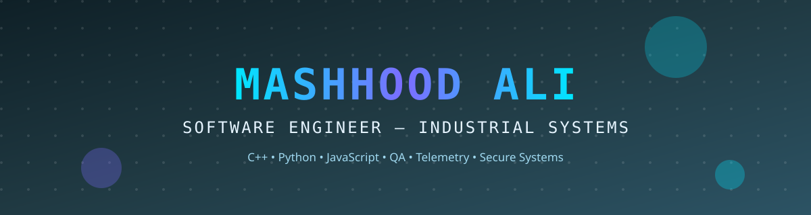

## 👋 About

Software Engineering undergraduate at MAJU, Karachi, building reliable software for industrial and infrastructure systems. Hands-on in C/C++, web development, and QA — now growing into Python, TypeScript, React, and FastAPI, one public project at a time.

📍 Karachi, Pakistan — open to remote & on-site roles

## 🛠️ Core stack

## 🌱 Growing into

## 🚀 Featured systems

| System | Stack | What it does |
|---|---|---|
| [Telemetry Logger & Dashboard](https://github.com/MASHHOOD2019/Applied-Systems-.-DEV/tree/main/telemetry-logger) | Python, FastAPI, SQLite, JS | Industrial data-logging API with a live dashboard and sensor simulator |
| [Secure Local Vault](https://github.com/MASHHOOD2019/Applied-Systems-.-DEV/tree/main/secure-vault) | Python, cryptography | Offline encrypted credential store — PBKDF2 + Fernet, master password never stored |
| [QA Bug Tracker Dashboard](https://github.com/MASHHOOD2019/Applied-Systems-.-DEV/tree/main/qa-bug-tracker) | HTML, CSS, JavaScript | Full bug lifecycle tool with triage filters, fix-rate stats, and JSON/CSV report export |

## 📊 Stats & activity

## 🐍 Contribution snake

<picture>
  <source media="(prefers-color-scheme: dark)" srcset="https://raw.githubusercontent.com/MASHHOOD2019/MASHHOOD2019/output/github-snake-dark.svg">
  <source media="(prefers-color-scheme: light)" srcset="https://raw.githubusercontent.com/MASHHOOD2019/MASHHOOD2019/output/github-snake.svg">
  
</picture>

*The snake is generated by a daily workflow — it appears after the first run completes.*

## 💼 Experience

- **AI Trainer / Quality Evaluator** — Mindrift (Remote)
- **Front-End UI Tester Intern** — Decode Labs
- **Software Intern** — CodeAlpha
- **HR Administrator / Technical Operations** — Freelance (Odoo, Outlook, MS Office)

## 🎓 Final-year project direction

Secure local databases • industrial automation tools • telemetry / data-logging software • enterprise dashboards

## 📫 Connect

[LinkedIn](https://linkedin.com/in/mashhood-ali-514862296) • mashhoodalisahito95@gmail.com • Fiverr: website QA, landing pages, C++ programs
